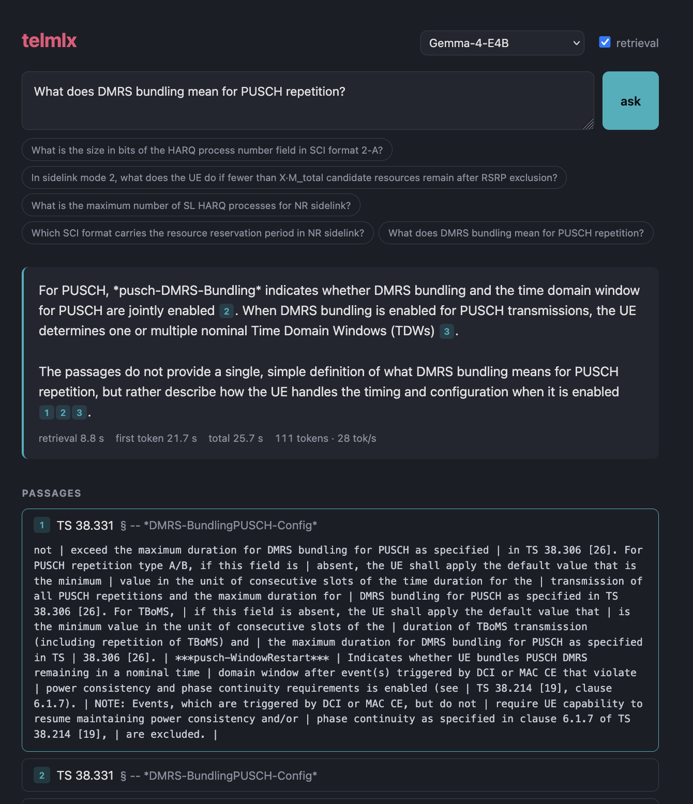

# telmlx

telmlx is a local retrieval augmented generation stack intended for helping through dense 3GPP and other telecom related documents. It is designed to run entirely on an Apple silicon Mac using `mlx_lm`. It is a proof of concept.

## Architecture

The stack consists of three MLX models on Apple silicon:
- **EmbeddingGemma-300M** for retrieval (FAISS index)
- **Qwen3-Reranker-0.6B** to rerank passages
- **Gemma-4-E4B** or **OTel-LLM-E4B-IT** to answer

Together they take about 6 GB of memory. On an M4 with 24 GB of unified memory, retrieval takes about 1.5 s and the answer streams in at 30 tokens/s.

```text
question ──▶ EmbeddingGemma ──▶ FAISS (93k chunks) ──▶ Qwen3-Reranker ──▶ top passages (+ neighbours)
                                                                                 │
browser ◀── streamed answer with [n] citations ◀── mlx_lm.server (Gemma-4-E4B) ◀─┘
```

- `rag/chunk.py` splits the specs into ~350-word chunks per clause, keeping the latest release. The corpus in use here is the 38-series markdown from TSpec-LLM.
- `rag/build_index.py` embeds every chunk with EmbeddingGemma and writes a FAISS index.
- `rag/proxy.py` is a FastAPI server. It does the retrieval and forwards an OpenAI-style chat request with the context prepended.
- `ui/` is a single React + TypeScript page

## Performance

Closed-book scores on the GSMA ot-lite benchmarks (GSMA's Inspect AI evals against `mlx_lm.server`, `scripts/eval.sh` + `scripts/rescore.py`):

|                     | TeleQnA (1000) | Standards specs subset (200) | TeleTables (100) | 3GPP-TSG (100)           |
| ------------------- | -------------- | ---------------------------- | ---------------- | ------------------------ |
| Gemma-4-E4B (stock) | **0.679**      | 0.515                        | **0.31**         | **0.25**                 |
| OTel-LLM-E4B-IT     | 0.610          | 0.485                        | 0.22             | 0.00 (abstains on 100 %) |

For my use case I would prefer the Gemma-4-E4B (or if you're seeing this in the future, any new SLM model)

## LoRA fine-tune

A LoRA adapter (of the following params: rank 16, α 32, 35M trainable parameters, 0.44 % with every attention and MLP projection of the text model) on Gemma-4-E4B bf16, trained on TeleQnA with the 1000 ot-lite questions removed (8522 train / 448 val) is also here. The target is the `ANSWER: X` line followed by TeleQnA's explanation. The adapter is then fused into the bf16 weights in MLX and quantised with `mlx_lm.convert`.

Both arms below went through the same fuse/convert path (the base with no adapter), 8-bit:

|                   | TeleQnA (1000) | Standards specs subset (200) | TeleTables (100) | 3GPP-TSG (100) |
| ----------------- | -------------- | ---------------------------- | ---------------- | -------------- |
| Gemma-4-E4B 8-bit | 0.708          | 0.580                        | 0.26             | **0.25**       |
| + TeleQnA LoRA    | **0.759**      | **0.660**                    | **0.27**         | 0.24           |

- On TeleQnA the LoRA gets 110 questions right that the base misses and loses 59 (McNemar p = 1e-4). The gain is largest on standards specifications (+8.0), research overview (+7.0) and lexicon (+10, n = 50); standards overview drops 3 points (n = 100).
- It does not transfer really, as TeleTables and 3GPP-TSG are within noise. The adapter learned TeleQnA-style telecom knowledge, not table reading or working-group classification.
- 8-bit alone is worth ~3 points over 4-bit on TeleQnA (0.708 vs 0.679).

```bash
python train/prep.py data/teleqna/TeleQnA.json data/teleqna/test_teleqna.json data/teleqna   # netop/TeleQnA is gated
train/submit.sh "--train data/teleqna/train.jsonl --val data/teleqna/val.jsonl --out /project_ghent/telmlx/runs/r16"
hf sync hf://buckets/vdesmond/telmlx-runs/r16 runs/r16
python train/fuse.py runs/r16/adapter models/gemma4-e4b-teleqna-bf16
mlx_lm.convert --hf-path models/gemma4-e4b-teleqna-bf16 --mlx-path models/gemma4-e4b-teleqna-8bit -q --q-bits 8
scripts/batch-lora.sh
```

- `train/lora.py` is plain transformers + peft
- `train/submit.sh` sends it to GPULab inside the job spec
- The stock `google/gemma-4-E4B-it` checkpoint still carries K/V weights for its 18 KV-shared layers, which `mlx_lm` refuses to load, and `train/fuse.py` drops them.

## Usage & Reproduce

```bash
uv sync
hf auth login                                  # TSpec-LLM is gated
python -c "from huggingface_hub import snapshot_download as s; s('rasoul-nikbakht/TSpec-LLM', repo_type='dataset', local_dir='data/tspec', allow_patterns=[f'3GPP-clean/Rel-{r}/38_series/*.md' for r in (17,18,19)])"
python rag/chunk.py data/tspec/3GPP-clean data/chunks.jsonl
python rag/build_index.py data/chunks.jsonl data/index     # ~2.5 h on an M4
cd ui && bun install && cd ..
scripts/demo.sh
```

`chunk.py` takes the spec series as extra arguments (default `38`). [5gs-monitor](https://github.com/vdesmond/5gs-monitor) uses a second, much smaller index over the Rel-18 core-network specs (TS 24.501, 29.244, 29.500, 29.510, 23.502), which its spec agent queries through `/rag/retrieve`:

```bash
python -c "from huggingface_hub import snapshot_download as s; s('rasoul-nikbakht/TSpec-LLM', repo_type='dataset', local_dir='data/tspec', allow_patterns=['3GPP-clean/Rel-18/24_series/24501-*.md', '3GPP-clean/Rel-18/29_series/29244-*.md', '3GPP-clean/Rel-18/29_series/29500-*.md', '3GPP-clean/Rel-18/29_series/29510-*.md', '3GPP-clean/Rel-18/23_series/23502-*.md'])"
python rag/chunk.py data/tspec/3GPP-clean data/core-chunks.jsonl 23 24 29
python rag/build_index.py data/core-chunks.jsonl data/core-index   # ~20 min on an M4
python rag/proxy.py --index data/core-index --chunks data/core-chunks.jsonl --port 8082
```



## References
- [TSpec-LLM Dataset](https://huggingface.co/datasets/rasoul-nikbakht/TSpec-LLM)
- [GSMA Open-Telco Benchmark (ot-lite)](https://huggingface.co/datasets/GSMA/ot-lite)
- [Open Telco (OTel)](https://github.com/farbodtavakkoli/OTel)
- [EmbeddingGemma-300M](https://huggingface.co/mlx-community/embeddinggemma-300m-bf16)
- [Qwen3-Reranker-0.6B](https://huggingface.co/mlx-community/Qwen3-Reranker-0.6B-4bit)
- [Gemma-4-E4B](https://huggingface.co/mlx-community/gemma-4-e4b-it-4bit)
